  

 

### Interfaces simples. Problemas interessantes.

Sou **José Novas**, Product Designer construindo a **Nort**. Conecto design, produto e tecnologia para transformar fluxos complexos em experiências claras — da primeira ideia aos detalhes de uma entrega real.

 

<table>
<tr>
<td width="33%" valign="top">
01 / DESIGN
<h3>Clareza em cada tela.</h3>

Hierarquia visual, interfaces e interações que ajudam as pessoas a seguir em frente.

</td>
<td width="33%" valign="top">
02 / PRODUTO
<h3>Intenção em cada escolha.</h3>

Entender o problema, simplificar o caminho e construir o que faz diferença.

</td>
<td width="33%" valign="top">
03 / CONSTRUÇÃO
<h3>Cuidado até a entrega.</h3>

Aproximar design e implementação, refinar os detalhes e evoluir com o uso real.

</td>
</tr>
</table>

 

#### AGORA / NORT

Uma plataforma de recrutamento. Meu foco está na experiência do produto: conectar pessoas e oportunidades com jornadas mais claras, do primeiro contato aos próximos passos.

**Produto real. Pessoas reais. Evolução contínua.**

 

---

  MENOS RUÍDO. MAIS INTENÇÃO. 
  José Novas · <a href="https://github.com/jose-nvs?tab=repositories">Explorar repositórios ↗</a>

